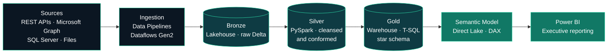

<!-- GitHub Profile README — Jaky Lindemberg -->

<div align="center">


<a href="https://www.linkedin.com/in/jaky-lindemberg"></a>
<a href="mailto:jaky.lindemberg@gmail.com"></a>
<a href="#microsoft-certifications"></a>

<sub><b>English</b> · <a href="#português">Português</a></sub>

</div>

<br/>

I design and deliver **end-to-end data platforms on Microsoft Fabric** — from source ingestion to governed semantic models and executive reporting. With **9+ years in data** and **five Microsoft certifications**, including **DP-700 (Fabric Data Engineer)** and **DP-600 (Fabric Analytics Engineer)**, I combine engineering discipline with business context to build data products that leadership relies on to make decisions.

My work spans the full data lifecycle: **PySpark** and **Python** pipelines, **T-SQL** warehousing, **dimensional modelling**, **DAX** semantic layers and **Power BI** reporting — engineered for reliability, performance and governance.

<div align="center">


</div>

<br/>

## Core Expertise

| Domain | What I deliver |
|---|---|
| **Data Engineering** | Batch ingestion with Fabric Data Pipelines and Dataflows Gen2; PySpark notebooks for transformation at scale; medallion architecture on Lakehouse with Delta Lake. |
| **Analytics Engineering** | Star-schema modelling, T-SQL Warehouse development, Direct Lake and Import semantic models, DAX measures and performance tuning. |
| **Business Intelligence** | Executive and operational Power BI solutions with KPI frameworks designed alongside directors and C-level stakeholders. |
| **Integration & Automation** | REST APIs, Microsoft Graph and Azure Management ingestion; Azure Functions, Logic Apps and Power Automate orchestration. |
| **Statistics & ML** | Exploratory analysis, correlation and distribution analysis, regression and classification models applied to business problems. |

<br/>

## Microsoft Certifications

<div align="center">

<table>
  <tr>
    <td align="center" width="190">
      <a href="https://learn.microsoft.com/api/credentials/share/en-us/JakyLindemberg-3618/B6E4441FD56396B1?sharingId=6EE237B93CB33367"></a><br/>
      <b>DP-700</b><br/><sub>Fabric Data Engineer<br/>Associate</sub>
    </td>
    <td align="center" width="190">
      <a href="https://learn.microsoft.com/api/credentials/share/en-us/JakyLindemberg-3618/611184C1AAEE0A9B?sharingId=6EE237B93CB33367"></a><br/>
      <b>DP-600</b><br/><sub>Fabric Analytics Engineer<br/>Associate</sub>
    </td>
    <td align="center" width="190">
      <a href="https://learn.microsoft.com/api/credentials/share/en-us/JakyLindemberg-3618/6E5891C4C7E1BDFD?sharingId=6EE237B93CB33367"></a><br/>
      <b>PL-300</b><br/><sub>Power BI Data Analyst<br/>Associate</sub>
    </td>
    <td align="center" width="190">
      <a href="https://learn.microsoft.com/api/credentials/share/en-us/JakyLindemberg-3618/7E6A2769B50C6103?sharingId=6EE237B93CB33367"></a><br/>
      <b>AI-900</b><br/><sub>Azure AI<br/>Fundamentals</sub>
    </td>
    <td align="center" width="190">
      <a href="https://learn.microsoft.com/api/credentials/share/en-us/JakyLindemberg-3618/70F204735ECF5095?sharingId=6EE237B93CB33367"></a><br/>
      <b>PL-900</b><br/><sub>Power Platform<br/>Fundamentals</sub>
    </td>
  </tr>
</table>

<sub>All credentials are verifiable on Microsoft Learn — click any badge.</sub>

</div>

<br/>

## Reference Architecture

How I structure end-to-end solutions on Microsoft Fabric:



<br/>

## Engineering Principles

| Principle | In practice |
|---|---|
| **Reliable by design** | Idempotent loads, incremental processing with Delta `MERGE`, and pipelines that are safe to re-run. |
| **Quality at every layer** | Schema enforcement, deduplication and validation rules between Bronze, Silver and Gold. |
| **Model for the business** | Star schemas and semantic models built around the decisions stakeholders need to make. |
| **Governed and secure** | Workspace and item permissions, row-level security and certified, reusable semantic models. |
| **Performance and cost aware** | Partitioning, V-Order and Direct Lake to keep refreshes fast and capacity usage under control. |

<br/>

## Code Samples

A glimpse of how I write production code across the stack.

<details>
<summary><b>PySpark</b> — incremental upsert from Bronze to Silver with Delta Lake</summary>

```python
from delta.tables import DeltaTable
from pyspark.sql import Window, functions as F

latest = Window.partitionBy("ticket_id").orderBy(F.col("updated_at").desc())

silver_df = (
    spark.read.table("bronze.tickets")
    .filter(F.col("ticket_id").isNotNull())
    .withColumn("status", F.upper(F.trim("status")))
    .withColumn("opened_at", F.to_timestamp("opened_at"))
    .withColumn("updated_at", F.to_timestamp("updated_at"))
    .withColumn("_rn", F.row_number().over(latest))
    .filter("_rn = 1")
    .drop("_rn")
    .withColumn("_processed_at", F.current_timestamp())
)

(
    DeltaTable.forName(spark, "silver.tickets").alias("t")
    .merge(silver_df.alias("s"), "t.ticket_id = s.ticket_id")
    .whenMatchedUpdateAll(condition="s.updated_at > t.updated_at")
    .whenNotMatchedInsertAll()
    .execute()
)
```

</details>

<details>
<summary><b>T-SQL</b> — Gold layer view in the Fabric Warehouse</summary>

```sql
CREATE OR ALTER VIEW gold.vw_service_desk_sla
AS
SELECT
    d.calendar_date,
    t.service_desk,
    COUNT(*)                                                    AS tickets_opened,
    AVG(DATEDIFF(MINUTE, t.opened_at, t.resolved_at) * 1.0)     AS avg_resolution_minutes,
    SUM(CASE WHEN t.resolved_at <= t.sla_due_at THEN 1 ELSE 0 END) * 1.0
        / NULLIF(COUNT(t.resolved_at), 0)                       AS sla_compliance
FROM silver.tickets AS t
INNER JOIN gold.dim_date AS d
    ON d.calendar_date = CAST(t.opened_at AS date)
GROUP BY
    d.calendar_date,
    t.service_desk;
```

</details>

<details>
<summary><b>DAX</b> — SLA compliance measure in the semantic model</summary>

```dax
SLA Compliance % =
VAR ResolvedTickets =
    CALCULATE ( COUNTROWS ( Tickets ), NOT ISBLANK ( Tickets[ResolvedAt] ) )
VAR WithinSLA =
    CALCULATE (
        COUNTROWS ( Tickets ),
        FILTER (
            Tickets,
            NOT ISBLANK ( Tickets[ResolvedAt] )
                && Tickets[ResolvedAt] <= Tickets[SLADueAt]
        )
    )
RETURN
    DIVIDE ( WithinSLA, ResolvedTickets )
```

</details>

<br/>

## Track Record

- **Hours to minutes.** Re-engineered data collection and transformation workflows with Python and Azure Functions, cutting processing time from hours to minutes.
- **Decision-grade reporting.** Power BI solutions used by directors and corporate clients to manage IT operations, security, service management and performance.
- **Data at scale.** Pipelines that process audit logs and telemetry from Microsoft cloud environments to support monitoring and governance.
- **Six years of operational analytics.** Built the reporting backbone of multiple contact-centre operations (SLA, AHT, abandonment, adherence), replacing manual spreadsheets with automated SQL-driven reports.

<br/>

## Technology Stack

<div align="center">

**Languages**<br/>


**Data Platform**<br/>


**Cloud & Integration**<br/>


**BI & Automation**<br/>


**Data Science & Engineering Practices**<br/>


</div>

<br/>

## Currently

- **Building** a portfolio of end-to-end Microsoft Fabric projects — public repositories coming soon.
- **Deepening** CI/CD for Fabric with Git integration and deployment pipelines.
- **Exploring** Real-Time Intelligence with Eventstreams, Eventhouse and KQL.

<br/>

---

<a id="português"></a>

## Português

Projeto e entrego **plataformas de dados end-to-end no Microsoft Fabric** — da ingestão das fontes até modelos semânticos governados e relatórios executivos. Com **mais de 9 anos em dados** e **cinco certificações Microsoft**, incluindo **DP-700 (Fabric Data Engineer)** e **DP-600 (Fabric Analytics Engineer)**, uno rigor de engenharia e visão de negócio para construir produtos de dados que sustentam as decisões da liderança.

Minha atuação cobre todo o ciclo de vida do dado: pipelines em **PySpark** e **Python**, data warehouse em **T-SQL**, **modelagem dimensional**, camadas semânticas em **DAX** e relatórios em **Power BI**, projetados para confiabilidade, performance e governança.

**Especialidades**

- **Engenharia de Dados:** ingestão com Data Pipelines e Dataflows Gen2, transformação em escala com notebooks PySpark e arquitetura medallion em Lakehouse com Delta Lake.
- **Analytics Engineering:** modelagem star schema, desenvolvimento de Warehouse em T-SQL, modelos semânticos Direct Lake e Import, DAX e otimização de performance.
- **Business Intelligence:** soluções executivas e operacionais em Power BI, com frameworks de KPIs definidos junto a diretores e executivos.
- **Integração e Automação:** ingestão via APIs REST, Microsoft Graph e Azure Management; orquestração com Azure Functions, Logic Apps e Power Automate.
- **Estatística e ML:** análise exploratória, correlação, distribuições e modelos de regressão e classificação aplicados a problemas de negócio.

**Resultados**

- Reestruturei fluxos de coleta e transformação de dados com Python e Azure Functions, **reduzindo o tempo de processamento de horas para minutos**.
- Soluções em Power BI utilizadas por diretores e clientes corporativos na gestão de operações de TI, segurança e serviços.
- Pipelines que processam logs de auditoria e telemetria de ambientes Microsoft em larga escala, apoiando monitoramento e governança.
- Seis anos construindo a base analítica de operações de contact center, substituindo planilhas manuais por relatórios automatizados em SQL.

**Princípios de engenharia**

- **Confiável por design:** cargas idempotentes, processamento incremental com `MERGE` em Delta e pipelines seguros para reexecução.
- **Qualidade em todas as camadas:** controle de schema, deduplicação e regras de validação entre Bronze, Silver e Gold.
- **Modelagem orientada ao negócio:** star schemas e modelos semânticos construídos em torno das decisões que a liderança precisa tomar.
- **Governança e segurança:** permissões por workspace e item, row-level security e modelos semânticos certificados e reutilizáveis.
- **Performance e custo:** particionamento, V-Order e Direct Lake para refreshes rápidos e uso de capacidade sob controle.

**Atualmente**

- **Construindo** um portfólio de projetos end-to-end no Microsoft Fabric — repositórios públicos em breve.
- **Aprofundando** CI/CD no Fabric com Git integration e deployment pipelines.
- **Explorando** Real-Time Intelligence com Eventstreams, Eventhouse e KQL.

**Certificações Microsoft:** DP-700 · DP-600 · PL-300 · AI-900 · PL-900

---

<div align="center">

**Open to opportunities in Data Engineering, Analytics Engineering and Microsoft Fabric.**<br/>
<sub>Aberto a oportunidades em Engenharia de Dados, Analytics Engineering e Microsoft Fabric.</sub>

<br/>

<a href="https://www.linkedin.com/in/jaky-lindemberg"></a>


</div>
