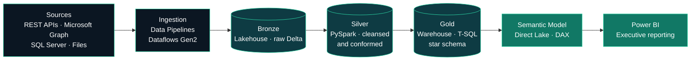

<div align="center">


<a href="https://www.linkedin.com/in/jaky-lindemberg"></a>
<a href="mailto:jaky.lindemberg@gmail.com"></a>
<a href="https://wa.me/5511989814320"></a>
<a href="#microsoft-certifications"></a>

<sub><b>English</b> · <a href="#português">Português</a></sub>

</div>

<br/>

I'm a data professional based in São Paulo with **9+ years of experience**. Today most of my work happens on **Microsoft Fabric**, where I take projects from start to finish: bringing data in from APIs and databases, cleaning and modelling it with **PySpark** and **SQL**, and delivering semantic models and **Power BI** reports that people use to run the business.

Before that, I spent six years in contact-centre BI, building reports with SQL, Excel and VBA. That's where I learned to care about data that is correct, on time and easy to understand.

I hold **five Microsoft certifications**, including **DP-700 (Fabric Data Engineer)** and **DP-600 (Fabric Analytics Engineer)**.

<div align="center">


</div>

<br/>

## What I Work With

| Area | Day to day |
|---|---|
| **Data Engineering** | Ingestion with Data Pipelines and Dataflows Gen2, PySpark notebooks for transformations, and Bronze, Silver and Gold layers in the Lakehouse with Delta tables. |
| **Analytics Engineering** | Dimensional modelling (star schema), T-SQL in the Fabric Warehouse, Direct Lake and Import semantic models, DAX measures and performance tuning. |
| **Business Intelligence** | Executive and operational Power BI reports, with KPIs defined together with managers and directors. |
| **Integration & Automation** | Data collection from REST APIs, Microsoft Graph and Azure Management, with automations in Python, Azure Functions, Logic Apps and Power Automate. |
| **Statistics & ML** | Exploratory, correlation and distribution analysis, plus regression and classification models for business questions. |

<br/>

## Microsoft Certifications

<div align="center">

<table>
  <tr>
    <td align="center" width="190">
      <a href="https://learn.microsoft.com/api/credentials/share/en-us/JakyLindemberg-3618/B6E4441FD56396B1?sharingId=6EE237B93CB33367"></a><br/>
      <b>DP-700</b><br/><sub>Fabric Data Engineer<br/>Associate</sub>
    </td>
    <td align="center" width="190">
      <a href="https://learn.microsoft.com/api/credentials/share/en-us/JakyLindemberg-3618/611184C1AAEE0A9B?sharingId=6EE237B93CB33367"></a><br/>
      <b>DP-600</b><br/><sub>Fabric Analytics Engineer<br/>Associate</sub>
    </td>
    <td align="center" width="190">
      <a href="https://learn.microsoft.com/api/credentials/share/en-us/JakyLindemberg-3618/6E5891C4C7E1BDFD?sharingId=6EE237B93CB33367"></a><br/>
      <b>PL-300</b><br/><sub>Power BI Data Analyst<br/>Associate</sub>
    </td>
    <td align="center" width="190">
      <a href="https://learn.microsoft.com/api/credentials/share/en-us/JakyLindemberg-3618/7E6A2769B50C6103?sharingId=6EE237B93CB33367"></a><br/>
      <b>AI-900</b><br/><sub>Azure AI<br/>Fundamentals</sub>
    </td>
    <td align="center" width="190">
      <a href="https://learn.microsoft.com/api/credentials/share/en-us/JakyLindemberg-3618/70F204735ECF5095?sharingId=6EE237B93CB33367"></a><br/>
      <b>PL-900</b><br/><sub>Power Platform<br/>Fundamentals</sub>
    </td>
  </tr>
</table>

<sub>Click a badge to verify the credential on Microsoft Learn.</sub>

</div>

<br/>

## How I Structure a Fabric Project

The layout I usually follow, adapted to each case:



<br/>

## How I Work

- Loads are incremental and safe to re-run (Delta `MERGE`), so a failed run never duplicates data.
- Data is checked between layers: schema, duplicates and basic validation rules.
- Models are designed around the questions the business needs answered, not around the source tables.
- Access is controlled with workspace permissions and row-level security, and semantic models are shared instead of copied.
- I keep an eye on performance and capacity cost, using partitioning, V-Order and Direct Lake where they make sense.

<br/>

## Code Samples

Short examples of the kind of code I write day to day.

<details>
<summary><b>PySpark</b>: incremental upsert from Bronze to Silver with Delta Lake</summary>

```python
from delta.tables import DeltaTable
from pyspark.sql import Window, functions as F

latest = Window.partitionBy("ticket_id").orderBy(F.col("updated_at").desc())

silver_df = (
    spark.read.table("bronze.tickets")
    .filter(F.col("ticket_id").isNotNull())
    .withColumn("status", F.upper(F.trim("status")))
    .withColumn("opened_at", F.to_timestamp("opened_at"))
    .withColumn("updated_at", F.to_timestamp("updated_at"))
    .withColumn("_rn", F.row_number().over(latest))
    .filter("_rn = 1")
    .drop("_rn")
    .withColumn("_processed_at", F.current_timestamp())
)

(
    DeltaTable.forName(spark, "silver.tickets").alias("t")
    .merge(silver_df.alias("s"), "t.ticket_id = s.ticket_id")
    .whenMatchedUpdateAll(condition="s.updated_at > t.updated_at")
    .whenNotMatchedInsertAll()
    .execute()
)
```

</details>

<details>
<summary><b>T-SQL</b>: Gold layer view in the Fabric Warehouse</summary>

```sql
CREATE OR ALTER VIEW gold.vw_service_desk_sla
AS
SELECT
    d.calendar_date,
    t.service_desk,
    COUNT(*)                                                    AS tickets_opened,
    AVG(DATEDIFF(MINUTE, t.opened_at, t.resolved_at) * 1.0)     AS avg_resolution_minutes,
    SUM(CASE WHEN t.resolved_at <= t.sla_due_at THEN 1 ELSE 0 END) * 1.0
        / NULLIF(COUNT(t.resolved_at), 0)                       AS sla_compliance
FROM silver.tickets AS t
INNER JOIN gold.dim_date AS d
    ON d.calendar_date = CAST(t.opened_at AS date)
GROUP BY
    d.calendar_date,
    t.service_desk;
```

</details>

<details>
<summary><b>DAX</b>: SLA compliance measure in the semantic model</summary>

```dax
SLA Compliance % =
VAR ResolvedTickets =
    CALCULATE ( COUNTROWS ( Tickets ), NOT ISBLANK ( Tickets[ResolvedAt] ) )
VAR WithinSLA =
    CALCULATE (
        COUNTROWS ( Tickets ),
        FILTER (
            Tickets,
            NOT ISBLANK ( Tickets[ResolvedAt] )
                && Tickets[ResolvedAt] <= Tickets[SLADueAt]
        )
    )
RETURN
    DIVIDE ( WithinSLA, ResolvedTickets )
```

</details>

<br/>

## Results

- Rebuilt data collection and transformation workflows with Python and Azure Functions, bringing processing time down from hours to minutes.
- Power BI reports used by directors and corporate clients to follow IT operations, security and service management.
- Pipelines that process audit logs and telemetry from Microsoft environments for monitoring and governance.
- Six years in contact-centre BI, replacing manual spreadsheets with SQL-connected reports for SLA, AHT, abandonment and adherence.

<br/>

## Technology Stack

<div align="center">

**Languages**<br/>


**Data Platform**<br/>


**Cloud & Integration**<br/>


**BI & Automation**<br/>


**Data Science & Tools**<br/>


</div>

<br/>

## Currently

- Preparing end-to-end Fabric projects to publish here on GitHub.
- Studying CI/CD for Fabric: Git integration and deployment pipelines.
- Exploring Real-Time Intelligence with Eventstreams, Eventhouse and KQL.

<br/>

---

<a id="português"></a>

## Português

Sou profissional de dados em São Paulo, com **mais de 9 anos de experiência**. Hoje a maior parte do meu trabalho acontece no **Microsoft Fabric**, onde conduzo projetos do início ao fim: trago dados de APIs e bancos de dados, faço a limpeza e a modelagem com **PySpark** e **SQL**, e entrego modelos semânticos e relatórios em **Power BI** que as áreas usam no dia a dia.

Antes disso, passei seis anos em BI de contact center, criando relatórios com SQL, Excel e VBA. Foi ali que aprendi a valorizar dado correto, no prazo e fácil de entender.

Tenho **cinco certificações Microsoft**, entre elas **DP-700 (Fabric Data Engineer)** e **DP-600 (Fabric Analytics Engineer)**.

**Com o que trabalho**

- **Engenharia de Dados:** ingestão com Data Pipelines e Dataflows Gen2, transformações em notebooks PySpark e camadas Bronze, Silver e Gold no Lakehouse com tabelas Delta.
- **Analytics Engineering:** modelagem dimensional (star schema), T-SQL no Warehouse do Fabric, modelos semânticos Direct Lake e Import, medidas DAX e ajuste de performance.
- **Business Intelligence:** relatórios executivos e operacionais em Power BI, com KPIs definidos junto com gestores e diretores.
- **Integração e Automação:** coleta de dados de APIs REST, Microsoft Graph e Azure Management, com automações em Python, Azure Functions, Logic Apps e Power Automate.
- **Estatística e ML:** análise exploratória, de correlação e de distribuições, além de modelos de regressão e classificação para perguntas de negócio.

**Como eu trabalho**

- As cargas são incrementais e podem ser reexecutadas com segurança (`MERGE` em Delta), então uma falha não duplica dados.
- Os dados são validados entre as camadas: schema, duplicidades e regras básicas.
- Os modelos são desenhados a partir das perguntas que o negócio precisa responder, e não a partir das tabelas de origem.
- O acesso é controlado com permissões de workspace e row-level security, e os modelos semânticos são compartilhados em vez de copiados.
- Acompanho performance e custo de capacidade, usando particionamento, V-Order e Direct Lake quando fazem sentido.

**Resultados**

- Refiz fluxos de coleta e transformação de dados com Python e Azure Functions, reduzindo o tempo de processamento de horas para minutos.
- Relatórios em Power BI usados por diretores e clientes corporativos para acompanhar operações de TI, segurança e gestão de serviços.
- Pipelines que processam logs de auditoria e telemetria de ambientes Microsoft para monitoramento e governança.
- Seis anos em BI de contact center, trocando planilhas manuais por relatórios conectados ao SQL para SLA, TMA, abandono e aderência.

**Atualmente**

- Preparando projetos end-to-end no Fabric para publicar aqui no GitHub.
- Estudando CI/CD no Fabric: Git integration e deployment pipelines.
- Explorando Real-Time Intelligence com Eventstreams, Eventhouse e KQL.

**Certificações Microsoft:** DP-700 · DP-600 · PL-300 · AI-900 · PL-900

---

<div align="center">

**Open to Data Engineering, Analytics Engineering and Microsoft Fabric roles.**<br/>
<sub>Aberto a vagas de Engenharia de Dados, Analytics Engineering e Microsoft Fabric.</sub>

<br/>

<a href="https://www.linkedin.com/in/jaky-lindemberg"></a>
<a href="https://wa.me/5511989814320"></a>


</div>
